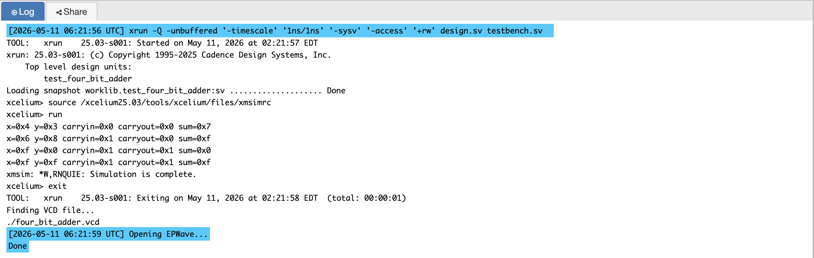
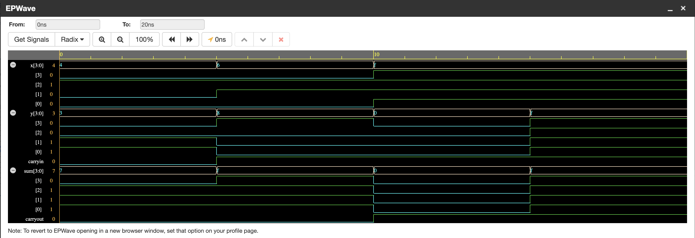

# P01 — 4-Bit Ripple Carry Adder in Verilog

My first RTL project. Two 4-bit numbers go in, a 4-bit sum and a carry flag
come out — and the whole point was to see how a line of Verilog turns into
an actual chain of full adders.

I chose an adder deliberately: it is small enough to reason about completely
on paper, but it already contains the two ideas that separate combinational
from sequential design (no clock, outputs respond to inputs) and it exposes
carry behaviour, which is where arithmetic bugs live for the rest of my
life as a hardware person.

---

## What It Does

```text
inputs : x[3:0], y[3:0], carryin
outputs: sum[3:0], carryout
```

Whenever the result exceeds 15 — the largest value four bits can hold —
`carryout` goes high, meaning the answer needed a fifth bit. That flag is
not an error condition; it is the same carry a CPU's `ADC` instruction
consumes to chain multi-word arithmetic.

---

## Block Diagram

```text
       A3 B3       A2 B2       A1 B1       A0 B0
       |  |        |  |        |  |        |  |
       V  V        V  V        V  V        V  V
    +-------+   +-------+   +-------+   +-------+
Cout|       |   |       |   |       |   |       |
<---|  FA3  |<--|  FA2  |<--|  FA1  |<--|  FA0  |<--- Cin
    |       | C3|       | C2|       | C1|       |
    +-------+   +-------+   +-------+   +-------+
        |           |           |           |
        V           V           V           V
        S3          S2          S1          S0
```

---

## How It Works

The design is a single `always @(*)` block:

```verilog
{carryout, sum} = x + y + carryin;
```

That concatenation on the left is the trick I had to be shown before it
clicked. The left-hand side is five bits wide (1 carry + 4 sum), so Verilog
takes the natural five-bit result of the addition and simply *keeps* the
fifth bit instead of throwing it away. It is one line, but it is also
exactly what the chain of full adders above is doing physically: each stage
computes a sum bit and a carry, and the final carry is `carryout`.

Using `always @(*)` rather than `assign` here is a style choice, not a
functional one — both synthesise to the same gates. I preferred the
procedural form because the moment a design gains a `default` case or
several conditions, `always @(*)` is where the code naturally goes, and I
wanted to get used to reading it.

One thing I checked carefully: the sensitivity list. `@(*)` watches every
input it reads, so the output updates the instant any input changes. With
an incomplete sensitivity list — `always @(x or y)` once `carryin` exists —
simulation and synthesis disagree, which is one of the nastiest bug classes
in Verilog. `@(*)` removes the possibility entirely.

---

## Simulation Output



---

## EPWave Waveform



---

## Test Cases

The testbench walks four vectors, chosen so each one exercises a different
corner of the arithmetic:

| x | y | carryin | Binary x | Binary y | Expected sum | carryout |
|---|---|---------|----------|----------|--------------|----------|
| 4 | 3 | 0 | 0100 | 0011 | 0111 (7) | 0 |
| 6 | 8 | 1 | 0110 | 1000 | 1111 (15) | 0 |
| 15 | 0 | 1 | 1111 | 0000 | 0000 (0) | 1 |
| 15 | 15 | 1 | 1111 | 1111 | 1111 (15) | 1 |

Why these four:

1. **4 + 3, no carry-in** — the boring baseline. If this fails, nothing
   else is worth debugging.
2. **6 + 8 + 1 = 15** — the carry-in arrives, the sum lands exactly on the
   4-bit maximum, and no carry-out appears. The boundary *just inside* the
   range.
3. **15 + 0 + 1 = 16** — the boundary *just outside*: carry-in ripples
   through all four stages, sum wraps to `0000`, carry-out sets.
4. **15 + 15 + 1 = 31** — maximum plus maximum: `carryout = 1` and
   `sum = 1111`.

$monitor prints every change, so the log is a running trace rather than a
pass/fail verdict — appropriate here, because at this stage I wanted to
*see* the values move.

---

## Files

| File | Description |
|------|-------------|
| `four_bit_adder.v` | RTL design module |
| `testbench.v` | Testbench with four test vectors |
| `simulation_output.png` | Console output from the simulation |
| `epwave_waveform.png` | EPWave waveform of the test |

---

## Tools Used

- EDA Playground — online Verilog simulator
- Cadence Xcelium — simulation engine
- EPWave — waveform viewer

---

## What I Learned

The concrete takeaways I still use:

- **Carry is width, not logic you have to invent.** `{carryout, sum} = ...`
  works because the left-hand side decides how many bits are kept. The gate
  level version — `sum = x ^ y ^ cin`, `carry = majority(x, y, cin)` — is
  what `+` abstracts away, and knowing both is the difference between using
  Verilog and understanding it.
- **`always @(*)` vs `assign` is about readability, not hardware.** Same
  synthesis result; the procedural form scales better to multi-branch logic.
- **Test vectors should target boundaries, not just random values.** Three
  of my four vectors sit at or next to 15, because that is where the carry
  actually behaves interestingly. Random tests between 0 and 10 would all
  have passed and taught me nothing about overflow.
- **`$monitor` for exploration, assertions for regression.** This project
  taught me to read traces; the later projects teach me to make the
  simulator check itself.
