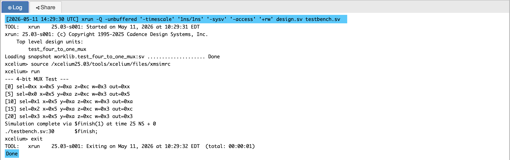
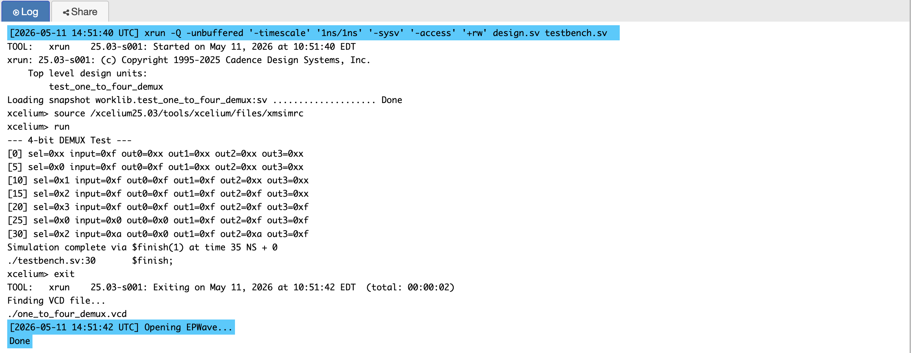
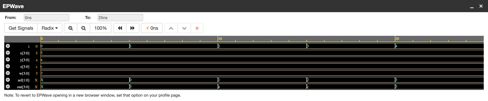
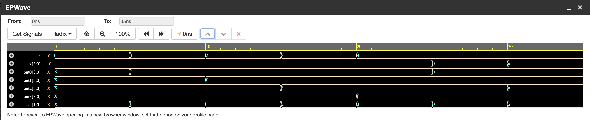

# P02 — 4-Bit 4-to-1 Multiplexer and 1-to-4 Demultiplexer

Two sides of the same coin: a multiplexer picks one of four 4-bit inputs
and routes it to a single output; a demultiplexer takes one 4-bit input and
routes it to one of four outputs. I built them together because they are
the same `case` statement with the select line on opposite sides of it, and
seeing that symmetry in code made the hardware feel obvious.

Every CPU datapath is built out of these things — the ALU source mux, the
write-back mux, the address decoder that becomes a register write-enable.
Getting them right here meant getting the debugging instinct right for
everything after.

---

## What They Do

### Multiplexer (4-to-1)

```text
Inputs  : x, y, z, w  — four 4-bit numbers
Select  : sel [1:0]
Output  : out [3:0]

sel = 00 → out = x
sel = 01 → out = y
sel = 10 → out = z
sel = 11 → out = w
```

### Demultiplexer (1-to-4)

```text
Input   : x [3:0]
Select  : sel [1:0]
Outputs : out0 .. out3

sel = 00 → out0 = x, others 0
sel = 01 → out1 = x, others 0
sel = 10 → out2 = x, others 0
sel = 11 → out3 = x, others 0
```

---

## Block Diagram

```text
     ┌─────────────┐
x ──►│             │
y ──►│  4-to-1 MUX │────► out
z ──►│             │
w ──►└─────────────┘
          ▲
         sel [1:0]


     ┌──────────────┐
     │              ├────► out0
x ──►│  1-to-4 DEMUX├────► out1
     │              ├────► out2
     └──────────────┘────► out3
          ▲
         sel [1:0]
```

---

## How It Works

Both designs are one `case` on `sel` inside `always @(*)`, with a `default`
branch at the end.

**`always @(*)` instead of a hand-written sensitivity list.** I learned
this the slightly embarrassing way: my first version read
`always @(x or sel)`, it simulated fine, and then I added input `z` and the
output silently stopped updating for that input. The `@(*)` form watches
everything the block reads, so adding an input can never break the
sensitivity list. It is a five-character habit that removes a whole class
of bug.

**The `default` branch is not optional.** A `case` without `default` in a
combinational block infers a latch when a value of `sel` is not covered —
the block "remembers" the last output, which is not what combinational logic
should do. Synthesis tools will warn, and if you wave the warning away you
get a flop you never drew. For a 2-bit select all four branches exist, but
I write `default` on principle now.

**MUX and DEMUX are transposes of each other.** In the MUX the `case`
selects which input reaches the output; in the DEMUX it selects which output
receives the input. Same statement, swapped operands — which is also the
intuition behind crossbar switches.

---

## Simulation Output

### MUX



### DEMUX



---

## EPWave Waveform

### MUX



### DEMUX



---

## Test Cases

### MUX

| sel | x | y | z | w | Expected output |
|-----|------|------|------|------|-----------------|
| 00 | 0101 | 1010 | 1100 | 0011 | 0101 |
| 01 | 0101 | 1010 | 1100 | 0011 | 1010 |
| 10 | 0101 | 1010 | 1100 | 0011 | 1100 |
| 11 | 0101 | 1010 | 1100 | 0011 | 0011 |

Every input carries a distinct pattern on purpose. If `sel = 01` accidentally
routed `x`, the output would be `0101` instead of `1010` — the mismatch is
visible in one glance, no mental binary-to-decimal conversion required.

### DEMUX

| x | sel | out0 | out1 | out2 | out3 |
|------|-----|------|------|------|------|
| 1111 | 00 | 1111 | 0000 | 0000 | 0000 |
| 1111 | 01 | 0000 | 1111 | 0000 | 0000 |
| 1111 | 10 | 0000 | 0000 | 1111 | 0000 |
| 1111 | 11 | 0000 | 0000 | 0000 | 1111 |
| 0000 | 00 | 0000 | 0000 | 0000 | 0000 |
| 1010 | 10 | 0000 | 0000 | 1010 | 0000 |

The important part of a demux test is not the selected output — it is the
**three outputs that must stay zero**. The classic demux bug is input
leaking onto an unselected port, and only checking the active port would
never catch it. I added the all-zeros input row for the same reason: a
design that ORs or gates inputs wrongly often stays hidden until the input
goes quiet.

The testbench uses `$monitor`, so every transition prints itself without me
placing `$display` calls at each step — useful when I want to watch a
sequence rather than assert it.

---

## Files

| File | Description |
|------|-------------|
| `mux_four_to_one.v` | RTL — 4-to-1 multiplexer |
| `testbench_mux_four_to_one.v` | Testbench for the MUX |
| `demux_one_to_four.v` | RTL — 1-to-4 demultiplexer |
| `testbench_demux_one_to_four.v` | Testbench for the DEMUX |
| `simulation_output_mux.png` | Console output for the MUX test |
| `simulation_output_demux.png` | Console output for the DEMUX test |
| `epwave_waveform_mux.png` | EPWave waveform for the MUX test |
| `epwave_waveform_demux.png` | EPWave waveform for the DEMUX test |

---

## Tools Used

- EDA Playground — online HDL simulator
- Cadence Xcelium — simulation engine
- EPWave — waveform viewer

---

## What I Learned

- **`case` is the natural encoding for one-hot style selection.** An
  if/else chain works, but the case statement maps directly onto the mux
  hardware and reads like the truth table it implements.
- **`@(*)` beats any hand-written sensitivity list.** The bug I described
  above happened to me in real life; the fix is permanent.
- **For a demux, verify the silence.** The unselected outputs are the
  ones that lie, so they get equal attention in every test case.
- **Give test inputs unique signatures.** Distinct patterns turn a wrong
  routing into an obvious mismatch instead of a coincidence.
- **`default` in every combinational `case`.** Latch inference from an
  incomplete case is a synthesis-time surprise I would rather never have
  again.
