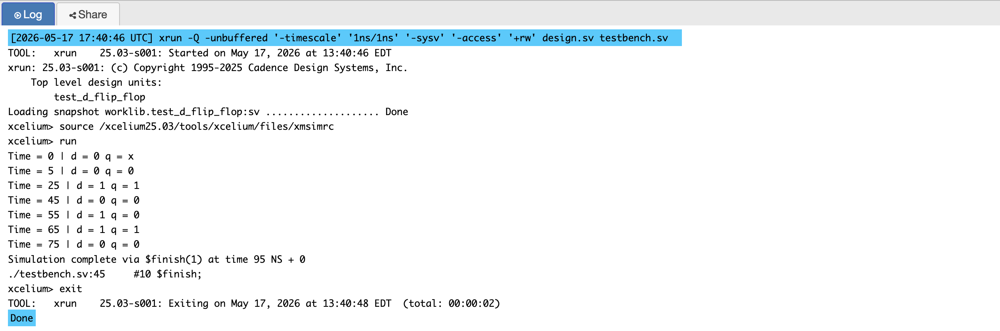
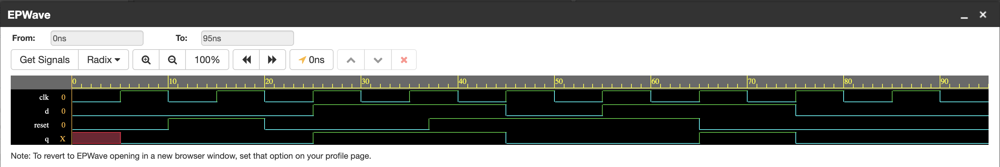
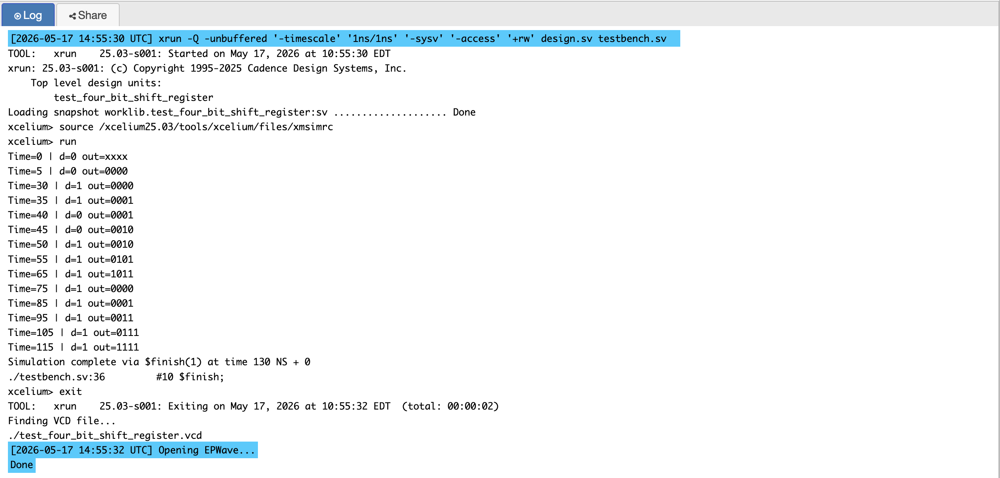
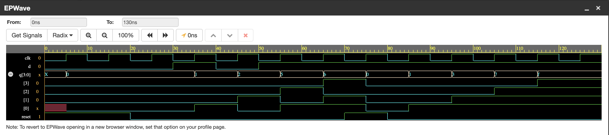

# P03 — D Flip-Flop and 4-Bit SIPO Shift Register

Two circuits that store things: a single D flip-flop holding one bit, and a
4-bit serial-in/parallel-out shift register built by chaining four of them.
This is where the design gains a clock, and where I had to stop thinking in
truth tables and start thinking in *edges*.

I paired them in one project on purpose. A flip-flop alone is an exercise;
a shift register is the same flip-flop four times with a story — and the
moment the second one stops being "four separate modules" and starts being
one register with a behaviour, sequential logic makes sense.

---

## Circuit 1 — D Flip-Flop

### Behaviour

```text
On posedge clk:
  if reset = 1  →  q = 0        (synchronous clear)
  else          →  q = d        (capture)
```

The value on `d` is captured on the rising clock edge and held until the
next one. `reset` is synchronous: it only takes effect at a clock edge, so
`q` never changes in between edges.

### Block Diagram

```text
        +------------------+
   d ──►│                  │
        │   D Flip-Flop    ├──► q
 clk ──►│  (sync reset)    │
reset──►│                  │
        +------------------+
```

### Why synchronous reset

I started with `always @(posedge clk or posedge reset)` because that is what
async reset looks like everywhere, then read up on why most synthesised
designs avoid it. An asynchronous reset has to be recovered from anywhere in
the cycle — it becomes a timing path of its own, with recovery and removal
checks, and a badly timed reset deassertion can violate them. A synchronous
reset shares the clock's domain: it is one more condition inside the clocked
block, and timing analysis treats it like any other data. That is the
default in the VLSI world, so that is what I used.

### Simulation Output



### EPWave Waveform



### Test Cases

Five scenarios, roughly in the order I would debug a broken flip-flop:

1. **Power-on state** — start with reset low and `d` low, confirm `q` comes
   up at a known value rather than X.
2. **Reset asserted** — `reset` high, `q` clears on the next edge, and not
   before (the waveform shows the *synchronous* part of synchronous reset).
3. **Normal capture** — reset released, `d` driven high, `q` follows on the
   following edge.
4. **Reset during operation** — `reset` asserted while `d` is high. Reset
   wins; if it did not, the priority of the two inputs would be wrong.
5. **Recovery** — reset released again and the flip-flop captures normally,
   proving reset left no stuck state behind.

---

## Circuit 2 — 4-Bit SIPO Shift Register

### Behaviour

```text
On posedge clk:
  if reset = 1  →  q = 0000
  else          →  q = {q[2:0], d}

shifting in 1, 0, 1, 1:
  clock 1 → q = 0001
  clock 2 → q = 0010
  clock 3 → q = 0101
  clock 4 → q = 1011
```

One bit enters per clock; the concatenation `{q[2:0], d}` shifts everything
left and drops the new bit into position zero. After four clocks the four
most recent bits are all readable at once on `q[3:0]` — serial in, parallel
out.

### Block Diagram

```text
        +------------------------------------------+
        |        4-Bit SIPO Shift Register         |
   d ──►│ [FF3] ◄── [FF2] ◄── [FF1] ◄── [FF0] ◄──d│
        |   q[3]     q[2]     q[1]     q[0]        |
 clk ──►│                                          |
reset──►│                                          |
        +──q[3]──────q[2]──────q[1]──────q[0]──────+
                 Parallel Output q[3:0]
```

This is not an abstract exercise: a UART receiver does exactly this —
collect eight serial bits, then hand the byte to the processor in one read.
The pattern `1011` I shift in here is also the pattern P05's sequence
detector hunts for, so the two projects use the same bits from opposite
ends.

### Simulation Output



### EPWave Waveform



### Test Cases

1. **Shift in `1, 0, 1, 1`** — must produce `1011`, the same pattern P05
   detects. Watching the register fill one bit per clock is the clearest
   demonstration of what "serial" means.
2. **Reset mid-operation** — assert reset while data is held; `q` must
   clear to `0000` on the next edge, not stay frozen.
3. **All-ones boundary** — shift in four consecutive `1`s to confirm the
   register reaches and holds `1111`, the upper edge of its range.

---

## Files

| File | Description |
|------|-------------|
| `d_flip_flop.v` | 1-bit D flip-flop with synchronous reset |
| `test_d_flip_flop.v` | Testbench for the flip-flop |
| `four_bit_shift_register.v` | 4-bit SIPO shift register |
| `test_four_bit_shift_register.v` | Testbench for the shift register |
| `simulation_output_flip_flop.png` | Console output — flip-flop test |
| `simulation_output_register.png` | Console output — shift register test |
| `epwave_waveform_flip_flop.png` | EPWave waveform — flip-flop test |
| `epwave_waveform_register.png` | EPWave waveform — shift register test |

---

## Tools Used

- EDA Playground — online Verilog/SystemVerilog simulator
- Cadence Xcelium — simulation engine
- EPWave — waveform viewer

---

## What I Learned

- **Everything sequential happens on one edge.** `posedge clk` is not a
  detail — it is the contract that makes digital systems predictable.
  Signals may wobble all they like between edges; the design only listens
  at the edge.
- **Synchronous reset keeps timing analysis simple.** Recovery/removal
  paths disappear when reset behaves like any other input on the clock.
- **Concatenation is the RTL way to express a shift.**
  `{q[2:0], d}` is synthesisable, readable, and closer to what the hardware
  does than a for-loop of assignments would be.
- **Four flip-flops with a shared story is one component.** The leap from
  "an FF" to "a register with a shift behaviour" is what makes counters,
  FIFOs and pipelines feel reachable afterwards.
- **Reset tests belong mid-operation.** Clearing at time zero only proves
  the power-on path; clearing while the register holds data proves the
  priority and the timing.
