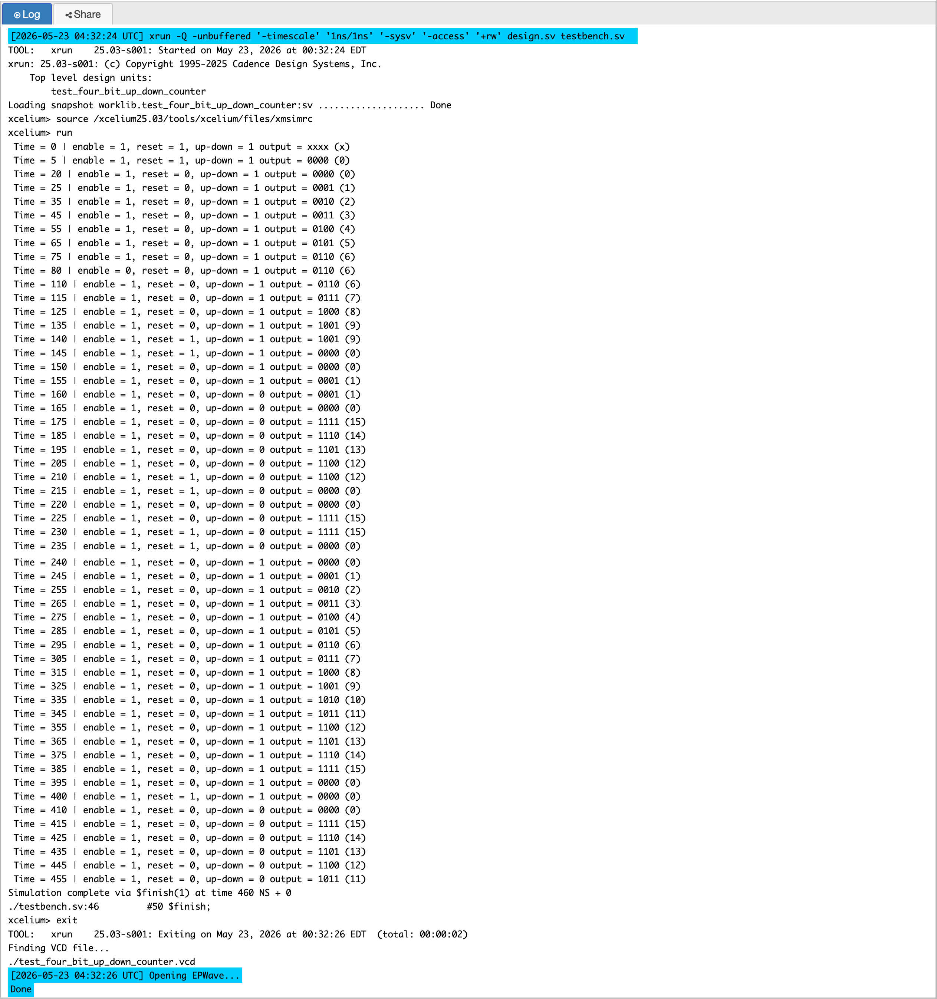
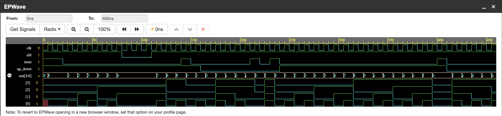

# P04 — 4-Bit Up/Down Counter with Enable and Synchronous Reset

A counter that increments or decrements on every rising clock edge, with an
enable to freeze it and a synchronous reset to clear it. Small block, but it
is the first place where I had to make *priority* explicit — three control
signals that cannot all be obeyed at once, and one clear order in which they
are obeyed.

Counters are everywhere in hardware: timers, baud-rate dividers (the UART in
P09 is literally a wrapped counter), address generators, FSM prescalers.
Learning to debug one properly paid off in every later project.

---

## Signals

| Signal | Direction | Width | Description |
|--------|-----------|-------|-------------|
| `clk` | in | 1 | Clock |
| `reset` | in | 1 | Synchronous, active-high — highest priority |
| `ebl` | in | 1 | Enable — count only when high |
| `up_down` | in | 1 | `1` = up, `0` = down |
| `out` | out | 4 | Current count (0–15) |

## How It Works

```text
On posedge clk:
  if reset = 1            → out = 0000        (clear, highest priority)
  else if ebl = 1:
        if up_down = 1    → out = out + 1     (count up)
        if up_down = 0    → out = out - 1     (count down)
  else                    → out holds         (enable low = freeze)
```

**Priority is visible in the code.** `reset` is the outermost condition, so
it overrides enable and direction no matter what they are doing. `ebl` sits
inside it, so a frozen counter ignores `up_down` entirely. My first instinct
was to write the three conditions as separate `if`s, and I stopped when I
realised that would let a reset be *ignored* while an enable was low — the
ordering in an if/else chain is literally the arbitration hardware you end
up with. This same thinking applies to pipeline hazard logic later: whoever
is checked first wins.

**Everything stays on `posedge clk`.** One clocked block, one edge, no
feedback loops. That makes the design's behaviour on the waveform a simple
staircase you can read directly.

**Wrap-around is a feature.** With four bits the arithmetic naturally
mod-16: `1111 + 1 = 0000` going up, `0000 - 1 = 1111` going down. I treat
that as intended behaviour rather than an overflow bug, because it is —
hardware counters wrap, and the UART baud generator in P09 depends on a
counter wrapping to zero to restart its period. What matters is that the
wrap is *defined*, not that it is a special case someone has to handle.

---

## Block Diagram

```text
     +----------------------------------------------+
     |          4-Bit Up/Down Counter               |
 clk ───►│  posedge clk trigger                    │
reset───►│  Priority 1 — clears to 0000            ├──► out [3:0]
  ebl───►│  Priority 2 — allows counting           │
up_dn───►│  Priority 3 — selects direction         │
     |  range 0000 (0) .. 1111 (15)               |
     |  1111 + 1 = 0000 (wraps)  0000 - 1 = 1111  |
     +----------------------------------------------+
```

---

## Simulation Output



---

## EPWave Waveform



---

## Test Cases Covered

The testbench runs through the control signals one at a time so that when a
value on the waveform surprises me, I know which input caused it:

| # | Scenario | What it proves |
|---|----------|----------------|
| 1 | Reset held at startup | `out` stays `0000` *during* reset and only changes on edges — synchronous behaviour |
| 2 | Count up with enable high | `0001, 0010, 0011, 0100, 0101…` — increment works |
| 3 | Enable dropped mid-count | output freezes exactly where it was |
| 4 | Enable re-asserted | counting resumes from the frozen value — no state lost |
| 5 | Reset mid-count | clears to `0000` on the next edge, beating enable and direction |
| 6 | Direction switched to down | output decrements — the other arithmetic path |
| 7 | Overflow and underflow | `1111 → 0000` counting up, `0000 → 1111` counting down |

Test 3/4 (freeze and resume) and test 7 (wrap) are the two I care about
most. Freezing is where a wrongly placed non-blocking assignment shows up,
and wrapping is where you discover whether your arithmetic is defined at
the edges or only in the comfortable middle of the range.

---

## Files

| File | Description |
|------|-------------|
| `four_bit_up_down_counter.v` | RTL — 4-bit up/down counter |
| `test_four_bit_up_down_counter.v` | Testbench covering the seven scenarios |
| `simulation_output.png` | Console output from the simulation |
| `epwave_waveform.png` | EPWave waveform of the test |

---

## Tools Used

- EDA Playground — online Verilog simulator
- Cadence Xcelium — simulation engine
- EPWave — waveform viewer

---

## What I Learned

- **Reset belongs on the outside of the if/else chain.** Buried inside
  other conditions it silently fails in exactly the case you did not think
  of. Outermost = highest priority = what hardware will implement.
- **The order of checks in RTL *is* the arbitration logic.** Once I saw
  that, priority encoding stopped being a separate topic to learn — it was
  already in my code.
- **Define your boundary behaviour on purpose.** Wrap-around is correct for
  this counter and incorrect for a saturating counter; deciding which one
  you want before writing the `+` saves an argument in review later.
- **Test control signals individually.** Enabling, disabling and resetting
  in one long sequence mixes causes; the waveform becomes hard to read and
  a failure becomes hard to attribute. One control change at a time, and
  the trace explains itself.
