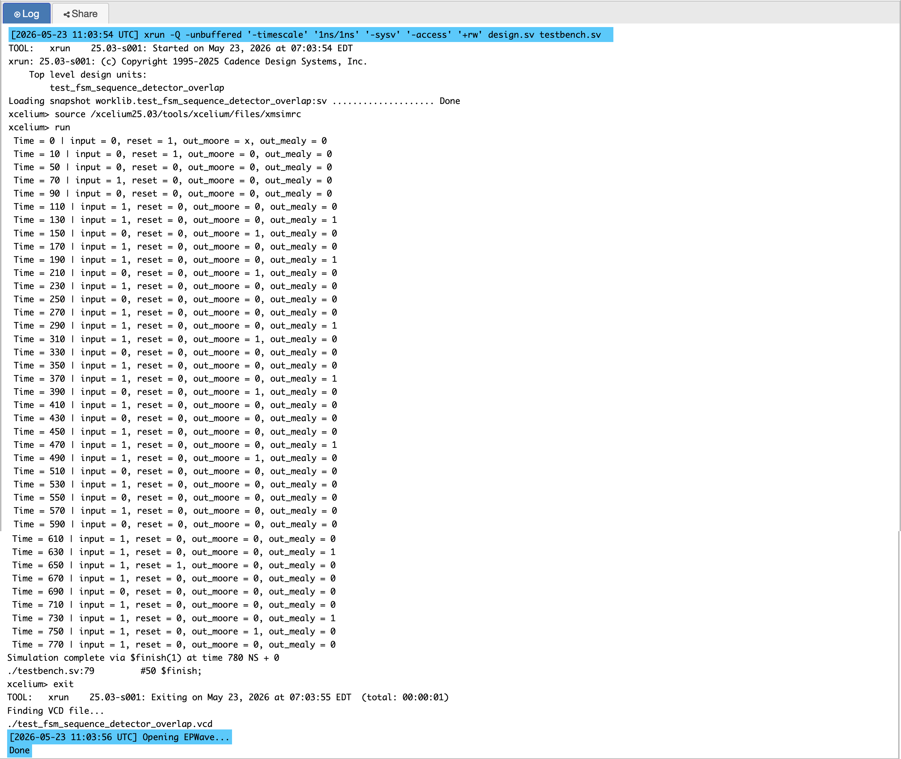
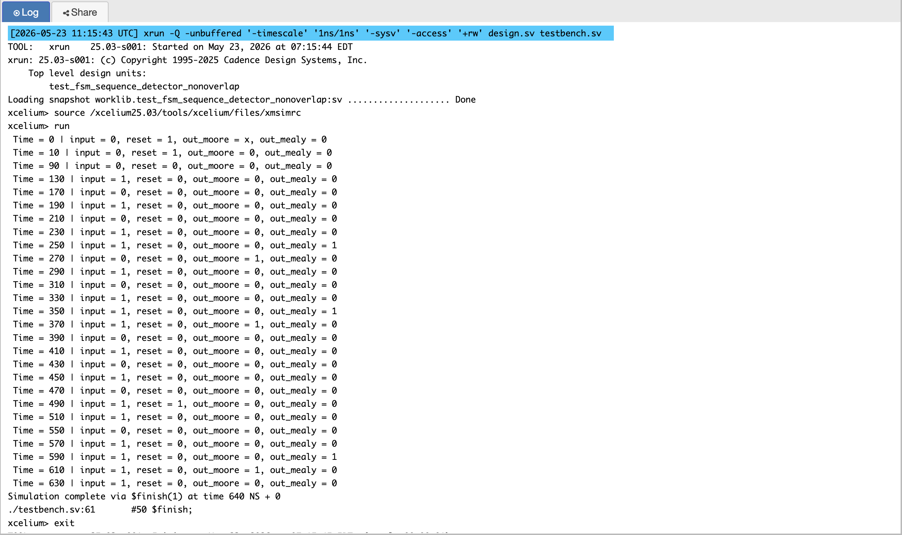
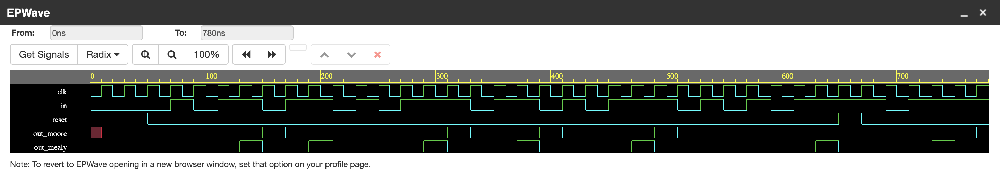
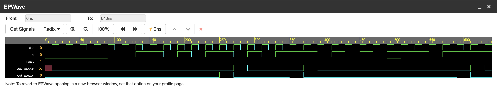

# P05 — FSM Sequence Detector for Pattern `1011`

A serial detector for the bit pattern `1011`, implemented four ways: Moore
and Mealy output styles, each in overlap and non-overlap variants. Same
problem, four machines, visibly different hardware — which is the entire
reason for building all four.

This is my favourite project in the beginner set. Everything before it was
combinational logic or a simple register; here the design has *state*, and
the quality of the design lives in how well I can draw the state diagram
before touching Verilog.

---

## The Four Designs

| Design | Output depends on | States | Detection |
|--------|-------------------|--------|-----------|
| Moore overlap | state only | 5 | after entering the detect state; shared bits allowed |
| Moore non-overlap | state only | 5 | after entering the detect state; search restarts |
| Mealy overlap | state + input | 4 | on the final input bit; shared bits allowed |
| Mealy non-overlap | state + input | 4 | on the final input bit; search restarts |

The detector samples one input bit per rising clock edge. When `1011` has
been seen, the output pulses high for one cycle.

---

## Why Build It Four Times

Moore and Mealy solve the same problem but disagree about where the output
comes from — the state alone, or the state *and* the current input. That
one disagreement changes the state count, the output timing, and the
hardware. Overlap vs non-overlap changes what happens *after* a detection:
whether the trailing bits of a completed pattern can start the next one.

Doing all four combinations side by side is what made the trade-offs real
instead of textbook:

- Moore = **stable output** (changes only on a clock edge), one extra state.
- Mealy = **faster output** (asserts with the final input bit), fewer states.
- Overlap = **keeps valid partial matches**, more detections from the same
  stream.
- Non-overlap = **clean restart**, simpler to reason about, misses the
  back-to-back cases.

---

## Pattern and Overlap

Target: `1011`.

```text
Input:   1 0 1 1 0 1 1
Pattern: 1 0 1 1
              1 0 1 1
Output:        1     1
```

With overlap, the final `1` of the first detection is also the first `1` of
the second — one input stream, two detections. Without overlap the FSM
returns to idle after the first detection and sees only one.

---

## State Meaning

| State | Meaning |
|-------|---------|
| `S` | no valid progress |
| `S1` | seen `1` |
| `S10` | seen `10` |
| `S101` | seen `101` |
| `S1011` | seen `1011` — Moore output state |

The Mealy machines never need `S1011`: the output is generated while in
`S101` the moment the input is `1`. That single missing state is the whole
"Mealy uses fewer states" claim, demonstrated concretely.

---

## Moore FSM

Output comes only from the current state, so the detector needs the extra
state to *be* in when the pattern is complete:

```verilog
assign out_moore = (curr_state == S1011) ? 1 : 0;
```

The output therefore changes only when the state register changes — it
cannot glitch in response to the input, which is what "Moore output is more
stable" means physically.

### Moore — Overlap

| Current state | in `0` | in `1` | Output |
|---------------|--------|--------|--------|
| `S` | `S` | `S1` | 0 |
| `S1` | `S10` | `S1` | 0 |
| `S10` | `S` | `S101` | 0 |
| `S101` | `S10` | `S1011` | 0 |
| `S1011` | `S10` | `S1` | 1 |

Note `S1011` on input `1` goes to `S1`, not `S`: the final `1` is already
the beginning of the next `1011`. That one transition *is* overlap mode.

### Moore — Non-Overlap

| Current state | in `0` | in `1` | Output |
|---------------|--------|--------|--------|
| `S` | `S` | `S1` | 0 |
| `S1` | `S10` | `S` | 0 |
| `S10` | `S` | `S101` | 0 |
| `S101` | `S10` | `S1011` | 0 |
| `S1011` | `S1` | `S1` | 1 |

After detection the FSM forgets partial progress and starts over — the
difference from the overlap table is a single cell, and it changes the
behaviour on whole input streams.

---

## Mealy FSM

The output is a function of state *and* input:

```verilog
if (curr_state == S101 && in == 1)
    out_mealy = 1;
```

The pulse arrives with the final input bit rather than a cycle later, and
`S1011` is unnecessary — four states instead of five.

### Mealy — Overlap

| Current state | in `0` | in `1` | Output |
|---------------|--------|--------|--------|
| `S` | `S` | `S1` | 0 |
| `S1` | `S10` | `S1` | 0 |
| `S10` | `S` | `S101` | 0 |
| `S101` | `S10` | `S1011`→ detected (output 1 on `in = 1`) | 1 when `in = 1` |

### Mealy — Non-Overlap

Same four states; the transition out of the detection point restarts from
`S` instead of keeping the trailing bits.

---

## Moore vs Mealy, and Overlap vs Non-Overlap

| Feature | Moore | Mealy |
|---------|-------|-------|
| Output depends on | current state | current state + input |
| States | 5 | 4 |
| Output timing | one cycle after the last bit | with the last bit |
| Output glitches | none (registered state only) | can respond to input within the cycle |

| Feature | Overlap | Non-overlap |
|---------|---------|-------------|
| Reuse of trailing bits | yes | no, restart after detection |
| Detections from `1011011` | two | one |
| Best for | continuous streams | independent pattern matches |
| Complexity | one extra transition | simpler, forgets partial match |

There is no "better" here — it depends on the protocol. That is the point I
took away: the spec decides, and the FSM is where the spec becomes
hardware.

---

## Coding Style — Two Always Blocks

```verilog
// 1. state register — the only storage
always @(posedge clk)
    if (reset) curr_state <= S;
    else       curr_state <= next_state;

// 2. next-state + output logic — pure combinational
always @(*) begin
    next_state = curr_state;
    out = 0;
    case (curr_state)
        ...
    endcase
end
```

I keep these strictly separate. Mixing the register and the combinational
logic into one block is the classic mistake: it simulates differently than
it synthesises, it invites latch inference, and timing analysis loses the
clean "one flop, everything else is gates" picture. The synthesiser then
maps exactly what the two blocks describe — a register for the state and
gates for the transitions — which is what makes the style trustworthy.

---

## Testbench Verification

Two testbenches, one per detection style. Each instantiates both the Moore
and Mealy versions of that style so their outputs can be compared on the
same waveform — the fastest way to *see* the timing difference.

- `test_fsm_sequence_detector_overlap.v`
- `test_fsm_sequence_detector_nonoverlap.v`

### Overlap coverage

1. **Correct detection** — apply `1011`, both outputs assert on the expected
   cycle (Moore one cycle later than Mealy, visible on the waveform).
2. **Overlapping back-to-back patterns** — `1011011` must produce two
   detections while preserving the shared bits.
3. **False pattern rejection** — partial and wrong sequences must not
   produce an output. Input `1010`, `1101`, `10110` … the detector stays
   quiet.
4. **Reset during a partial match** — assert reset while the FSM sits in
   `S101`; it must return to idle with no spurious pulse.

### Non-overlap coverage

1. **Correct detection** — single pulse on the final bit.
2. **Restart behaviour** — after detection, the FSM must not reuse the
   trailing bits of the pattern it just found.
3. **False pattern rejection** — same rejection suite as above.
4. **Reset during a partial match** — clears all progress.

---

## Simulation Output

### Overlap



### Non-Overlap



---

## EPWave Waveforms

### Overlap



### Non-Overlap



---

## Files

| File | Description |
|------|-------------|
| `fsm_sequence_detector_moore_overlap.v` | Moore FSM, overlap mode |
| `fsm_sequence_detector_moore_nonoverlap.v` | Moore FSM, non-overlap mode |
| `fsm_sequence_detector_mealy_overlap.v` | Mealy FSM, overlap mode |
| `fsm_sequence_detector_mealy_nonoverlap.v` | Mealy FSM, non-overlap mode |
| `test_fsm_sequence_detector_overlap.v` | Testbench for both overlap FSMs |
| `test_fsm_sequence_detector_nonoverlap.v` | Testbench for both non-overlap FSMs |
| `simulation_output_overlap.png` | Console output — overlap test |
| `simulation_output_nonoverlap.png` | Console output — non-overlap test |
| `epwave_waveform_overlap.png` | EPWave waveform — overlap test |
| `epwave_waveform_nonoverlap.png` | EPWave waveform — non-overlap test |

---

## Tools Used

- EDA Playground
- Cadence Xcelium
- EPWave

---

## What I Learned

- **Draw the state diagram first, write RTL second.** Every time I started
  from Verilog I ended up patching transitions; every time I started from
  the diagram the code almost wrote itself.
- **Moore vs Mealy is a timing and area trade-off, not a style
  preference.** One extra state for a glitch-free output, or one fewer
  state with an input-dependent pulse — you pick based on what the consumer
  of the output can tolerate.
- **Overlap lives in one transition.** The difference between the two
  Moore tables is a single cell. Big behavioural differences often hide in
  tiny structural differences, which is why transition tables are worth
  writing out fully.
- **Test rejection, not just detection.** A detector that fires on every
  input would pass a naive "does it detect `1011`" test. The false-pattern
  and mid-reset cases are what prove the FSM is right.
- **Two always blocks, always.** The discipline scales directly to any FSM
  I will write later — including the protocol controllers in the
  Intermediate projects.
