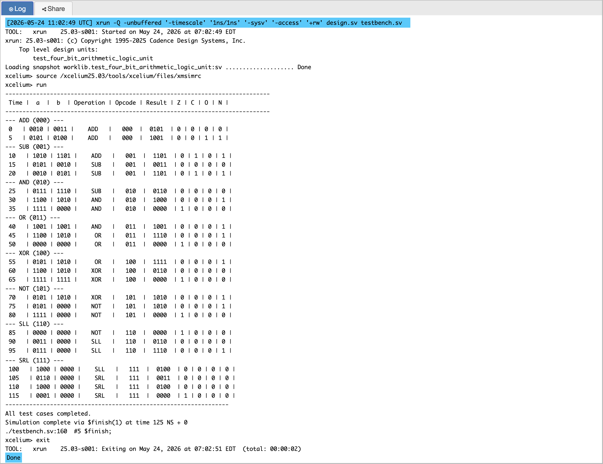
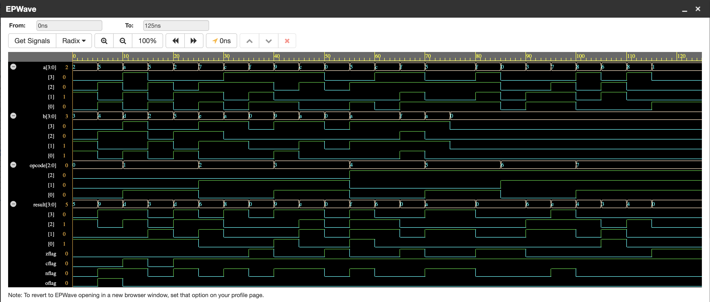

# P06 — 4-Bit Arithmetic Logic Unit (ALU)

Eight operations — four arithmetic, four logic — selected by a 3-bit opcode,
producing a 4-bit result plus the four status flags a processor's decision
logic needs: zero, negative, carry, overflow. This is the execute stage of
a CPU in miniature, and it is the project where I understood why a processor
needs *two* different notions of "the arithmetic went wrong".

I built it as the capstone of the beginner set: it uses the adder from P01,
the case/mux style from P02, and it feeds directly into the kind of
conditional logic a RISC-V core performs on every branch.

---

## Operations

| Opcode | Operation | Description |
|--------|-----------|-------------|
| `000` | `ADD` | A + B, unsigned carry detection |
| `001` | `SUB` | A − B, borrow + signed overflow detection |
| `010` | `AND` | bitwise AND |
| `011` | `OR` | bitwise OR |
| `100` | `XOR` | bitwise XOR |
| `101` | `NOT` | bitwise NOT of A (B ignored) |
| `110` | `SLL` | logical left shift of A by one |
| `111` | `SRL` | logical right shift of A by one |

## Interface

| Signal | Direction | Width | Description |
|--------|-----------|-------|-------------|
| `A`, `B` | in | 4 | operands |
| `opcode` | in | 3 | selects the operation |
| `result` | out | 4 | operation output |
| `zflag` | out | 1 | result is zero |
| `nflag` | out | 1 | result is negative (two's complement) |
| `cflag` | out | 1 | unsigned carry-out / borrow |
| `oflag` | out | 1 | signed overflow |

---

## Architecture

Everything is computed in parallel, and the opcode merely selects which
result reaches the output — the same structure as real ALU hardware, where
the arithmetic units are all live at once and a mux picks the winner:

```text
     A[3:0]              B[3:0]
        │                   │
  [ADD] [SUB] [AND] [OR] [XOR] [NOT] [SLL] [SRL]
        └───────┴────┴────┴─────┴─────┴─────┘
                         │
              ┌──────────────────┐
              │  8-to-1 selector │   ← case (opcode)
              └────────┬─────────┘
                       │
                  result[3:0]
                       │
        ┌──────────────┼──────────────┐
     zflag          nflag      cflag / oflag
  (result == 0)  (result[3])  (arithmetic only)
```

The implementation is one combinational block with every operation
evaluated and a `case` choosing the result. The discipline that matters
here: **every branch assigns every output**. An output that is only assigned
in *some* branches infers a latch — a bit of unwanted state inside what
should be pure combinational logic. I keep `default` branches and assign
flags from the *selected* result, not from whichever partial computation
happened to run.

---

## Status Flags

- **`zflag`** — `result == 4'b0000`. Branch-if-zero lives or dies on this.
- **`nflag`** — `result[3]`, the sign bit of a two's-complement number.
- **`cflag`** — carry out of the adder, or borrow out of the subtractor.
  This is the *unsigned* error signal: unsigned comparison and multi-word
  arithmetic chain on it.
- **`oflag`** — *signed* overflow: the answer does not fit in four signed
  bits. A different question from carry, answered with different logic.

### Why carry and overflow are not the same thing

This is the concept I had to sit with longest, and the one I would put at
the top of an interview whiteboard:

```text
  unsigned view:   15 + 1 = 16  → carry set, sum = 0000      (carry)
  signed view:      7 + 8 = 15  → +7 + +8 should be +15, but
                                  0111 + 1000 = 1111 = −1     (overflow)
```

Carry asks *"did the bits spill out of the unsigned range?"* Overflow asks
*"did the sign come out wrong?"* A CPU checks carry for unsigned
comparisons and overflow for signed ones — and using the wrong flag is a
real class of arithmetic bug.

The detection logic follows from that:

```verilog
oflag_add = (~A[3] & ~B[3] & result[3])      // + + → −
         | ( A[3] &  B[3] & ~result[3]);     // − − → +

oflag_sub = (A[3] ^ B[3]) & (A[3] ^ result[3]);
```

For addition: overflow only happens when both operands share a sign and the
result disagrees. For subtraction: when the operands have *different* signs
and the result's sign does not match the minuend's.

---

## Simulation Output



---

## EPWave Waveform



---

## Test Cases Covered

24 vectors — three per operation across all eight operations. Within each
trio the cases are chosen to hit a normal path, a boundary/flag condition,
and something specific for the negative flag:

| Operation | The three cases |
|-----------|-----------------|
| ADD | plain add; positive overflow (+7 + +8 → negative result); two negatives overflowing |
| SUB | plain sub; result negative → `nflag`; positive − negative → signed overflow |
| AND | mixed bits; identical inputs forcing zero → `zflag`; result with MSB set → `nflag` |
| OR | mixed bits; all-zero inputs → zero; complementary inputs → all ones → `nflag` |
| XOR | mixed bits; identical inputs → zero (XOR's identity); inverted inputs → all ones |
| NOT | positive → negative; `1111 → 0000` → `zflag`; `0000 → 1111` |
| SLL | plain shift; shifted MSB lands in the sign position; all bits shifted out → zero |
| SRL | plain shift; MSB was set (proving the shift is logical, not arithmetic); single 1 shifted out |

Two habits this table reflects: **every operation gets tested, not just
ADD**, and **each test targets a flag**, because flags are what the rest of
a processor actually consumes. Testing `ADD` for 20 vectors and `SRL` for
none produces a confident-looking log that proves very little.

---

## Files

| File | Description |
|------|-------------|
| `four_bit_arithmetic_logic_unit.v` | ALU RTL |
| `test_four_bit_arithmetic_logic_unit.v` | Testbench — 24 vectors, all operations |
| `simulation_output.png` | Console output |
| `epwave_waveform.png` | EPWave waveform |

---

## Tools Used

- EDA Playground — online Verilog simulator
- Cadence Xcelium — simulation engine
- EPWave — waveform viewer

---

## What I Learned

- **Combinational blocks must assign every output on every path.** One
  unassigned branch and synthesis hands you a latch you did not draw.
- **Flags are computed from the final selected result**, from the operands
  that produced it — never from an intermediate partial computation that
  happens to sit earlier in the block.
- **Carry and overflow answer different questions.** Unsigned range vs
  signed range; one status bit for each; a CPU needs both to do correct
  comparisons and branches.
- **Test coverage should mirror the operation table.** If the opcode table
  has eight rows, the test plan has eight sections — and each section
  should provoke at least one flag, because that is the ALU's output to the
  world.
- **This is the block the whole processor is organised around.** Seeing the
  mux-selects-a-function pattern here made the datapath diagrams in later
  material stop looking like decoration.
