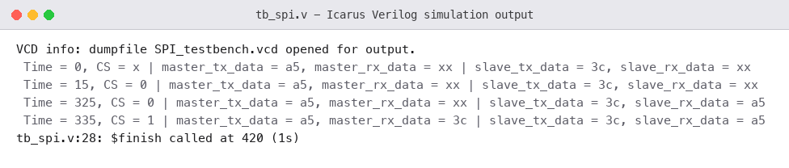
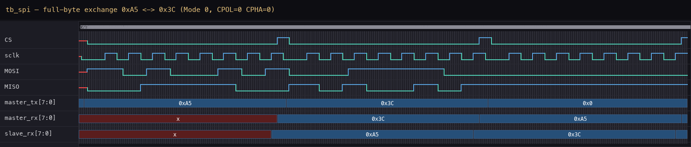

# P07 — SPI Master & Slave

Two SPI devices wired to each other: a master that generates the serial
clock and drives `MOSI`, and a slave that answers on `MISO`. Both sides
hold a full byte and exchange it one bit per clock, MSB first — the master
receives the slave's byte in exactly the eight cycles it sends its own,
which is the whole reason SPI is called full-duplex.

This is the first Intermediate project and the first time my design has to
agree with *another device* instead of a testbench that does whatever the
RTL needs. The mode is 0 — `CPOL = 0, CPHA = 0` — so `sclk` idles low,
data is launched on the falling edge and sampled on the rising edge, and
`CS` frames the transaction: low for the eight clocks of one byte, high
again between frames.

---

## Interface

| Signal | Direction | Description |
|--------|-----------|-------------|
| `clk`, `reset` | in | system clock, async reset |
| `load` | in | pulse to start one byte exchange |
| `master_tx_data[7:0]` | in | byte the master sends |
| `slave_tx_data[7:0]` | in | byte the slave sends |
| `CS` | out | chip select, active low |
| `sclk` | out | serial clock, 8 pulses per frame |
| `MOSI` | out | master-out-slave-in |
| `MISO` | out | slave-out-master-in |
| `master_rx_data[7:0]` | out | byte the master received |
| `slave_rx_data[7:0]` | out | byte the slave received |

---

## How It Works

The master counts `clk` down by four to produce `sclk`, asserts `CS` for
exactly eight serial clocks, and shifts its `tx_data` out on `MOSI` one bit
per falling edge. The slave watches `CS`: while it is low the slave shifts
its own byte out on `MISO` and samples `MOSI` on each rising `sclk` edge.
Both sides use the same discipline — sample on the edge the other side is
not driving on — which is what keeps the bits aligned without any
handshake beyond the clock itself.

```text
CS     ‾‾‾\_____________________________________________________/‾‾‾
sclk        _¯|_|¯|_|¯|_|¯|_|¯|_|¯|_|¯|_|¯|_|¯|_              8 pulses
MOSI        -<b7>-<b6>-<b5>-<b4>-<b3>-<b2>-<b1>-<b0>          master →
MISO        -<b7>-<b6>-<b5>-<b4>-<b3>-<b2>-<b1>-<b0>          slave  →
```

The full-duplex claim is visible in this timing: both bytes are on the
wire during the *same* eight clocks. There is no second frame for the
reply — SPI buys its speed with wires, one dedicated line per direction.

---

## Test Cases Covered

Three full exchanges with different byte patterns, each checked from both
sides, plus the `CS` framing check — 12 checks in total:

| Test | Exchange | What it proves |
|------|----------|----------------|
| T1 | `0xA5` ↔ `0x3C` | both sides receive the other's byte; mixed bit pattern |
| T2 | `0x3C` ↔ `0xA5` | same bytes swapped — direction is not hardcoded |
| T3 | `0x00` ↔ `0xFF` | all-zeros vs all-ones: every bit path toggles |
| CS | every frame | `CS` is low mid-frame and returns high after — framing, not free-running |

T2 exists because T1 alone cannot tell "master sends A5, slave sends 3C"
from a design that hardcodes which side owns which value — swapping the
bytes is the cheapest way to prove the datapath is symmetric.

---

## Simulation Output



---

## Waveform

Three frames, back to back. `CS` drops, eight `sclk` pulses, both bytes
cross in flight, and `master_rx` / `slave_rx` update at the end of each
frame with the *other* side's transmit byte:



---

## Files

| File | Description |
|------|-------------|
| `spi_master_slave.v` | master + slave RTL |
| `tb_spi.v` | self-checking testbench — 12 checks |
| `simulation_output.txt` | console log |
| `simulation_output.png` | console output image |
| `waveform.png` | waveform image (from the VCD dump) |

---

## Tools Used

- Icarus Verilog — simulation (`iverilog` / `vvp`)
- Surfer — waveform viewer (VCD dump; image rendered from it)

---

## What I Learned

- **Full-duplex is a sampling-edge agreement, not a feature list.** The
  master and slave exchange bytes in the same eight clocks only because
  both launch on the falling edge and sample on the rising one. Change the
  mode (`CPHA`) on one side only, and every bit shifts by one.
- **`CS` does framing work that the clock cannot.** Without `CS` between
  frames, the slave cannot tell one byte from the next — the bit counter
  would free-run. The testbench therefore checks `CS` explicitly, not just
  the data.
- **The first test should swap the bytes.** Symmetric exchange tests catch
  hardcoded-direction bugs that a single happy-path vector never will.
