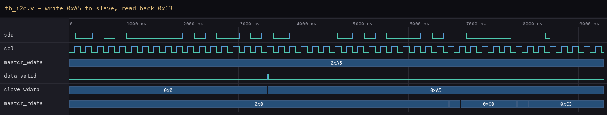

# P08 — I2C Master & Slave

I²C is SPI's opposite number: two wires shared by every device on the bus
(`sclk` and `sda`), open-drain so any device can pull the line low and
release it high, and addressing instead of chip-selects. Here a master
talks to one slave at address `0x28`, writing and reading single bytes,
and the slave latches whatever the master writes into a small register it
can hand back on a read.

I built this straight after SPI on purpose: same job — move a byte
between two chips — with the opposite constraints. Where SPI added wires
to gain simplicity, I²C removes wires and pays with protocol state. The
two bugs I hit below are both that price showing up.

---

## Interface

| Signal | Direction | Description |
|--------|-----------|-------------|
| `clk`, `reset` | in | system clock, async reset |
| `sda` | inout | serial data, open-drain |
| `sclk` | out | serial clock |
| `master_addr[6:0]` | in | address the master targets |
| `rw` | in | 0 = write, 1 = read |
| `data_in[7:0]` | in | byte the master sends |
| `start` | in | pulse to begin a transaction |
| `master_rdata[7:0]` | out | byte the master read back |
| `slave_addr[6:0]` | in | address the slave answers to |
| `slave_data_valid` | out | pulses when the slave latched a written byte |

---

## How It Works

A transaction is a fixed frame: `START` (a falling `sda` while `sclk` is
high), the 7-bit address plus the `R/W` bit, one ACK clock from the slave,
then — for a write — the data byte and its ACK, or — for a read — eight
bits driven by the slave and an ACK the master sends back. `STOP` (a
rising `sda` while `sclk` is high) releases the bus. The slave compares
every address byte against its own `slave_addr` and stays silent on a
mismatch.

```text
START  addr[6:0] + W   ACK   data[7:0]   ACK   STOP
  \      8 clocks     / 1   8 clocks    / 1     /
   sda falls while    slave pulls      slave    sda rises while
   sclk is high       sda low          ACKs     sclk is high
```

Open-drain changes the physical picture: nobody drives a logic 1 — every
device either pulls the wire low or releases it, and a pull-up resistor
provides the high. Contention is impossible by construction, and one
device can hold `sda` low (the ACK) while the master is still clocking.

### Two bugs the wire taught me

1. **The master emitted `START` on the wrong `sclk` edge.** `START` and
   `STOP` are defined as `sda` edges *while `sclk` is high*; my first
   version toggled `sda` on the same edge that moved `sclk`, so the
   condition never appeared cleanly on the bus — the slave never saw a
   frame begin. The fix was a small state machine that holds `sclk` high
   for the dedicated `START`/`STOP` states and only moves `sda` inside
   them.
2. **The slave counted the `START` edge as a data bit.** The edge detector
   feeding the slave's bit counter fired on the same transition that
   begins the frame, so the address arrived shifted by one bit and the
   slave never recognised itself. Gating the counter with an
   in-transaction flag fixed it — the first *real* bit is bit 6 of the
   address, not a phantom bit 7.

Both were invisible in the PASS/FAIL log — the waveform showed each in
one glance, which is the strongest argument I have for dumping VCDs even
when tests pass.

---

## Test Cases Covered

Six directed transactions, 10 checks, covering writes, reads, addressing,
and reset recovery:

| Test | Scenario | What it proves |
|------|----------|----------------|
| T1 | write `0xA5` to `0x28` | slave latches exactly one byte, correct value |
| T2 | write `0x5A` to `0x28` | second write works; not a one-shot |
| T3 | read from `0x28` | master receives the slave's byte `0xC3` |
| T4 | write to `0x29` (wrong address) | slave ignores it — `rx_count` unchanged |
| T5 | write `0x11`, then read `0x22` | back-to-back different transactions |
| T6 | reset mid-traffic, then write `0x99` | bus recovers after reset |

T4 costs one transaction and proves the slave's address decode is real,
not "always accept" — the cheapest structural test in the set.

---

## Simulation Output


---

## Waveform

One complete write transaction: `START`, address `0x28` + write bit, ACK,
data byte `0xA5`, ACK, `STOP`. The slave's state machine walks through its
address/ack/write states and latches the byte (`slave_data_valid` pulse at
the end):



---

## Files

| File | Description |
|------|-------------|
| `i2c_master.v` | master RTL |
| `i2c_slave.v` | slave RTL |
| `tb_i2c.v` | self-checking testbench — 10 checks |
| `simulation_output.txt` | console log |
| `simulation_output.png` | console output image |
| `waveform.png` | waveform image (from the VCD dump) |

---

## Tools Used

- Icarus Verilog — simulation (`iverilog` / `vvp`)
- GTKWave — waveform viewer (VCD dump; image rendered from it)

---

## What I Learned

- **I²C's control signals live in the *other* wire's idle time.** `START`
  and `STOP` are not clocked events — they are `sda` edges while `sclk` is
  high, which means the controller has to schedule bus changes around the
  clock, not along with it.
- **Open-drain is a physical-layer decision that simplifies everything
  above it.** Nobody can short anybody by driving the wrong level; the ACK
  works because the slave holds the line while the master keeps clocking.
- **Address decode is a one-bit-counter bug away from silent failure.**
  The off-by-one sampling bug looked, in the log, exactly like "the slave
  is broken". The waveform showed the real story in one glance — the state
  machine never left its address state.
- **Test the wrong address.** T4 proves the match logic matters; a slave
  that ACKs everything would pass T1–T3 and fail on a real bus.
