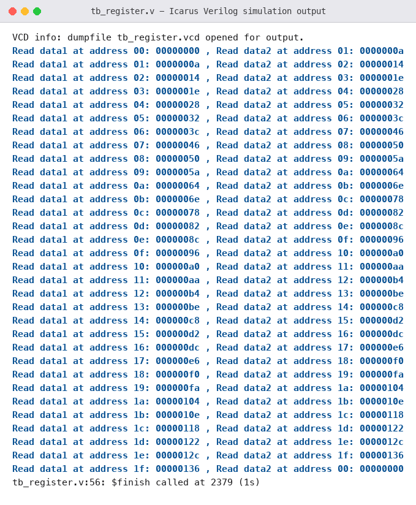
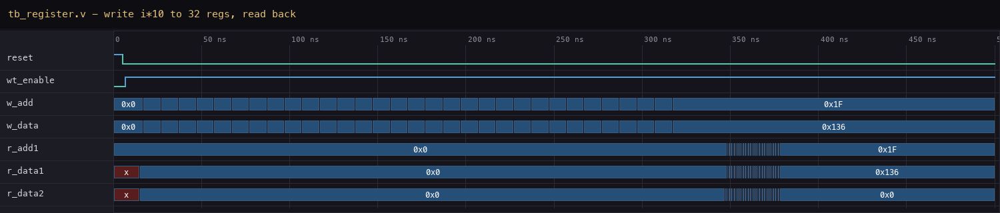

# P10 — 32 × 32 Register File

The last Intermediate project is not a protocol — it is the storage a
processor reads and writes: thirty-two 32-bit registers, one synchronous
write port, two asynchronous read ports. It is the `regs[]` array at the
heart of every RISC-V core, sized down just enough to keep the testbench
readable while the structure stays real.

This is the first project in the repository whose consumer is a *CPU*
rather than another chip on a wire. Everything before it in Intermediate
moved bytes between devices; this one holds the operands that the ALU
from P06 will one day consume — so the interface choices here are really
datapath choices.

---

## Interface

| Signal | Direction | Width | Description |
|--------|-----------|-------|-------------|
| `clk`, `reset` | in | 1 | system clock, async reset |
| `wt_enable` | in | 1 | write strobe |
| `w_add` | in | 5 | write address |
| `w_data` | in | 32 | write data |
| `r_add1`, `r_add2` | in | 5 | read addresses |
| `r_data1`, `r_data2` | out | 32 | read data (async) |

---

## How It Works

Writes are clocked: on a rising edge, if `wt_enable` is high, `w_data` is
stored at register `w_add`. Reads are combinational: `r_data1`
continuously returns the contents of `r_add1`, and likewise for port 2 —
so a value written on one edge is visible to both read ports immediately
after, the same "write first" behaviour a CPU datapath expects.

```text
                     ┌────────────────────────────┐
  w_add[4:0] ──────► │                            │
  w_data[31:0] ────► │   x[0..31]                 │ ───► r_data1[31:0]
  wt_enable ───────► │   one write port           │      (r_add1 selects)
  clk / reset ─────► │   two async read ports     │ ───► r_data2[31:0]
                     └────────────────────────────┘      (r_add2 selects)
```

One `always` block with a `for` loop clears all registers on reset and
writes the selected one on a clock edge; the two read ports are
continuous assignments. The design decision worth naming: reads are
*asynchronous* — deliberately, to match a single-cycle CPU's
register-read stage — so there is no read clock and no read latency. The
register index *is* the output. The trade-off I am accepting is that this
read path now sits in the design's critical timing loop.

---

## Test Cases Covered

Two sweeps over all 32 registers — a write pass and a read-back pass:

| Test | Scenario | What it proves |
|------|----------|----------------|
| T1 | write `i * 10` into every register, one write per clock | every address decodes; `w_add` counts 0 → 31 |
| T2 | read all 32 addresses back on both ports | values follow the pattern; port 2 wraps from 31 back to 0 |

Each register holds `address * 10`, so the log reads `0, a, 14, 1e …`
stepping by `0xA` — if an address decoded wrong, the step would break and
jump out of the log, no comparison code needed. The last line reads port
2 at address 0 while port 1 sits at address 31, which is the dual-port
claim checked in one row.

---

## Simulation Output



---

## Waveform

The reset pulse, then thirty-two back-to-back writes — `w_add` counts up,
`w_data` carries `0, 0xA, 0x14 … 0x136` — followed by the read-back
sweep, where `r_add1` walks the whole file in 32 ticks and both data
ports update as it goes:



---

## Files

| File | Description |
|------|-------------|
| `register_file.v` | register file RTL |
| `tb_register.v` | testbench — write sweep + read-back |
| `simulation_output.txt` | console log |
| `simulation_output.png` | console output image |
| `waveform.png` | waveform image (from the VCD dump) |

---

## Tools Used

- Icarus Verilog — simulation (`iverilog` / `vvp`)
- Surfer — waveform viewer (VCD dump; image rendered from it)

---

## What I Learned

- **Async reads are a real design choice, not laziness.** Making the read
  ports combinational is what lets a single-cycle processor fetch two
  operands in the execute stage; the cost is that the read path is now in
  the critical timing loop, and that trade-off is visible from the day you
  draw the block.
- **A pattern you can check by eye beats a scoreboard here.** `i * 10`
  means every read-back line must step by `0xA` — the log itself becomes
  the check, and the whole test stays a for-loop and a `$display`.
- **The write loop needs a delay per iteration.** My first version had
  none, so all 32 writes landed on the same clock edge and only the last
  address survived — the read-back came out all `x` until the `#10` went
  into the loop.
- **Reset is a loop, not a constant.** Clearing 32 words needs a `for`
  inside the `always` block; a single `x <= 0` would clear exactly one
  register and leave 31 of them stale.
- **This array is where "processor" starts.** The ALU from P06 and this
  register file are two halves of the same datapath — the next step is a
  fetch-decode-execute loop that drives both.
