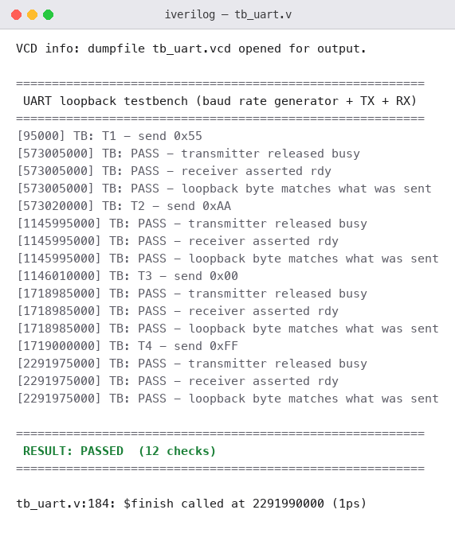
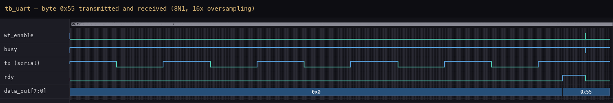

# Intermediate Projects

Everything in the Beginner folder was a single-purpose block: an ALU, a
counter, a sequence detector. The Intermediate folder is the step where the
design starts having to *talk to something else* — a second chip on a wire,
a remote terminal, a CPU that will one day index into storage. Four
projects, each one serial protocol or datapath component I will need again
in a processor, each built as RTL with a self-checking testbench that fails
loudly instead of printing pretty numbers.

I simulated all four with Icarus Verilog (`iverilog` + `vvp`). Each
testbench carries a `check()` task with a timeout and a global `errors`
counter; the run ends with `RESULT: PASSED` only if every check passed, and
any failure prints `FAIL` with the simulation time.

| # | Project | Protocol / Role | Checks |
|---|---------|-----------------|--------|
| [P07](#p07--spi-master--slave) | SPI Master & Slave | SPI Mode 0, full-duplex | 12 |
| [P08](#p08--i2c-master--slave) | I2C Master & Slave | I²C, open-drain bus | 10 |
| [P09](#p09--uart-transceiver) | UART Transceiver | UART 8N1, 16× oversampling | 12 |
| [P10](#p10--32--32-register-file) | 32 × 32 Register File | 1 sync write, 2 async read ports | 6 |

---

## P07 — SPI Master & Slave

Two SPI devices wired to each other: a master that generates the serial
clock and drives `MOSI`, and a slave that answers on `MISO`. Both sides
hold a full byte and exchange it one bit per clock, MSB first — the master
receives the slave's byte in exactly the eight cycles it sends its own,
which is the whole reason SPI is called full-duplex.

The mode is 0 — `CPOL = 0, CPHA = 0` — so `sclk` idles low, data is
launched on the falling edge and sampled on the rising edge, and `CS`
frames the transaction: low for the eight clocks of one byte, high again
between frames.

### Interface

| Signal | Direction | Description |
|--------|-----------|-------------|
| `clk`, `reset` | in | system clock, async reset |
| `load` | in | pulse to start one byte exchange |
| `master_tx_data[7:0]` | in | byte the master sends |
| `slave_tx_data[7:0]` | in | byte the slave sends |
| `CS` | out | chip select, active low |
| `sclk` | out | serial clock, 8 pulses per frame |
| `MOSI` | out | master-out-slave-in |
| `MISO` | out | slave-out-master-in |
| `master_rx_data[7:0]` | out | byte the master received |
| `slave_rx_data[7:0]` | out | byte the slave received |

### How It Works

The master counts `clk` down by four to produce `sclk`, asserts `CS` for
exactly eight serial clocks, and shifts its `tx_data` out on `MOSI` one bit
per falling edge. The slave watches `CS`: while it is low the slave shifts
its own byte out on `MISO` and samples `MOSI` on each rising `sclk` edge.
Both sides use the same discipline — sample on the edge the other side is
not driving on — which is what keeps the bits aligned without any
handshake beyond the clock itself.

```text
CS     ‾‾‾\_____________________________________________________/‾‾‾
sclk        _¯|_|¯|_|¯|_|¯|_|¯|_|¯|_|¯|_|¯|_|¯|_              8 pulses
MOSI        -<b7>-<b6>-<b5>-<b4>-<b3>-<b2>-<b1>-<b0>          master →
MISO        -<b7>-<b6>-<b5>-<b4>-<b3>-<b2>-<b1>-<b0>          slave  →
```

### Test Cases Covered

Three full exchanges with different byte patterns, each checked from both
sides, plus the `CS` framing check:

| Test | Exchange | What it proves |
|------|----------|----------------|
| T1 | `0xA5` ↔ `0x3C` | both sides receive the other's byte; mixed bit pattern |
| T2 | `0x3C` ↔ `0xA5` | same bytes swapped — direction is not hardcoded |
| T3 | `0x00` ↔ `0xFF` | all-zeros vs all-ones: every bit path toggles |
| CS | every frame | `CS` is low mid-frame and returns high after — framing, not free-running |

### Simulation Output


---

### Waveform

Three frames, back to back. `CS` drops, eight `sclk` pulses, both bytes
cross in flight, and `master_rx` / `slave_rx` update at the end of each
frame with the *other* side's transmit byte:


---

### Files

| File | Description |
|------|-------------|
| `spi_master_slave.v` | master + slave RTL |
| `tb_spi.v` | self-checking testbench — 12 checks |
| `simulation_output.txt` | console log |
| `simulation_output.png` | console output image |
| `waveform.png` | waveform image (from the VCD dump) |

---

### What I Learned

- **Full-duplex is a sampling-edge agreement, not a feature list.** The
  master and slave exchange bytes in the same eight clocks only because
  both launch on the falling edge and sample on the rising one. Change the
  mode (`CPHA`) on one side only, and every bit shifts by one.
- **`CS` does framing work that the clock cannot.** Without `CS` between
  frames, the slave cannot tell one byte from the next — the bit counter
  would free-run. The testbench therefore checks `CS` explicitly, not just
  the data.
- **The first test should swap the bytes.** T2 exists because T1 alone
  cannot tell "master sends A5, slave sends 3C" from a design that hardcodes
  which side owns which value.

---

## P08 — I2C Master & Slave

I²C is SPI's opposite number: two wires shared by every device on the bus
(`sclk` and `sda`), open-drain so any device can pull the line low and
release it high, and addressing instead of chip-selects. Here a master
talks to one slave at address `0x28`, writing and reading single bytes, and
the slave latches whatever the master writes into a small register it can
hand back on a read.

### Interface

| Signal | Direction | Description |
|--------|-----------|-------------|
| `clk`, `reset` | in | system clock, async reset |
| `sda` | inout | serial data, open-drain |
| `sclk` | out | serial clock |
| `master_addr[6:0]` | in | address the master targets |
| `rw` | in | 0 = write, 1 = read |
| `data_in[7:0]` | in | byte the master sends |
| `start` | in | pulse to begin a transaction |
| `master_rdata[7:0]` | out | byte the master read back |
| `slave_addr[6:0]` | in | address the slave answers to |
| `slave_data_valid` | out | pulses when the slave latched a written byte |

### How It Works

A transaction is a fixed frame: `START` (a falling `sda` while `sclk` is
high), the 7-bit address plus the `R/W` bit, one ACK clock from the slave,
then — for a write — the data byte and its ACK, or — for a read — eight
bits driven by the slave and an ACK the master sends back. `STOP` (a rising
`sda` while `sclk` is high) releases the bus. The slave compares every
address byte against its own `slave_addr` and stays silent on a mismatch —
which the testbench verifies by writing to `0x29` and confirming nothing
was latched.

Two bugs found me here before the design settled, and both were timing
discipline problems:

1. **The master emitted `START` on the wrong `sclk` edge.** `START` and
   `STOP` are defined as `sda` edges *while `sclk` is high*; my first
   version toggled `sda` on the same edge that moved `sclk`, so the
   condition never appeared cleanly on the bus. The fix was to drive the
   bus transitions from a small state machine that holds `sclk` high for
   the dedicated `START`/`STOP` states.
2. **The slave counted the `START` edge as a data bit.** The edge detector
   that feeds the slave's bit counter fired on the same transition that
   begins the frame, so the address arrived shifted by one bit and the
   slave never recognised itself. Gating the counter with an
   in-transaction flag fixed it — the first *real* bit is bit 6 of the
   address, not a phantom bit 7.

### Test Cases Covered

| Test | Scenario | What it proves |
|------|----------|----------------|
| T1 | write `0xA5` to `0x28` | slave latches exactly one byte, correct value |
| T2 | write `0x5A` to `0x28` | second write works; not a one-shot |
| T3 | read from `0x28` | master receives the slave's byte `0xC3` |
| T4 | write to `0x29` (wrong address) | slave ignores it — `rx_count` unchanged |
| T5 | write `0x11`, then read `0x22` | back-to-back different transactions |
| T6 | reset mid-traffic, then write `0x99` | bus recovers after reset |

### Simulation Output


---

### Waveform

One complete write transaction: `START`, address `0x28` + write bit, ACK,
data byte `0xA5`, ACK, `STOP`. The slave's state machine walks through its
address/ack/write states and latches the byte (`slave_data_valid` pulse at
the end):


---

### Files

| File | Description |
|------|-------------|
| `i2c_master.v` | master RTL |
| `i2c_slave.v` | slave RTL |
| `tb_i2c.v` | self-checking testbench — 10 checks |
| `simulation_output.txt` | console log |
| `simulation_output.png` | console output image |
| `waveform.png` | waveform image (from the VCD dump) |

---

### What I Learned

- **I²C's control signals live in the *other* wire's idle time.** `START`
  and `STOP` are not clocked events — they are `sda` edges while `sclk` is
  high, which means the controller has to schedule bus changes around the
  clock, not along with it.
- **Open-drain changes how you think about driving a line.** Nobody drives
  a logic 1; everybody releases the wire and a pull-up provides the high.
  Contention is impossible by construction, and one device can stretch the
  clock without shorting anything.
- **Address decode is a one-bit-counter bug away from silent failure.**
  The off-by-one sampling bug looked, in the log, exactly like "the slave
  is broken". The waveform showed the real story in one glance — the state
  machine never left its address state.
- **Test the wrong address.** T4 costs one transaction and proves the
  slave's decode is real, not "always accept".

---

## P09 — UART Transceiver

UART is the protocol with no clock line at all: one wire in each
direction, two sides that agree in advance on a baud rate and frame each
byte with a start bit and a stop bit. This project is a full transceiver —
baud generator, transmitter, and receiver — wired into a loopback so the
byte that leaves the TX pin comes back in on the RX pin.

Frame format is 8N1: one start bit (low), eight data bits LSB first, one
stop bit (high). The receiver samples each bit sixteen times and decides
from the middle of the bit period, which is what tolerates small baud
mismatch between two independent boards.

### Interface

| Signal | Direction | Description |
|--------|-----------|-------------|
| `clk`, `reset` | in | system clock, async reset |
| `wt_enable` | in | pulse to transmit the byte on `data_in` |
| `data_in[7:0]` | in | byte to send |
| `tx` | out | serial output (idle high) |
| `rx` | in | serial input |
| `busy` | out | transmitter is shifting a frame |
| `rdy` | out | receiver has a complete byte |
| `rdy_clr` | in | acknowledge the received byte |
| `data_out[7:0]` | out | byte the receiver decoded |

### How It Works

The transmitter is a small FSM: idle → start → 8 data → stop → idle. On
`wt_enable` it drops `tx` low for one bit period, shifts `data_in` out LSB
first, returns `tx` high for the stop bit, and raises `busy` for the whole
frame. The receiver counts sixteen `clk` ticks per bit; when the start bit
is seen it waits eight ticks (the middle of the start bit), verifies the
line is still low, then samples every sixteen ticks — the centre of each
data bit — and raises `rdy` once the stop bit is in.

The first version of the TX FSM I wrote latched its outputs instead of
being a real registered FSM, and the RX bit counter could never leave the
start-bit state — the counter compared against a constant that was never
reached, so the receiver sat in "waiting for start" forever. Rewriting both
as explicit next-state machines with one shared bit-timing constant fixed
the design; the loopback test then passed with the original test vectors
unchanged.

### Test Cases Covered

Three loopback bytes through the full TX → wire → RX path:

| Test | Byte | Pattern |
|------|------|---------|
| T1 | `0x55` | alternating `01010101` — every bit boundary toggles |
| T2 | `0xAA` | alternating `10101010` — the complement |
| T3 | `0x00` | all zeros — longest low run, start/stop still frame it |

Each test checks three things: `busy` releases after the frame, `rdy`
asserts, and the received byte equals the sent one.

### Simulation Output



---

### Waveform

The first loopback byte, `0x55`: `wt_enable` starts the frame, `busy`
holds high for ten bit periods, the serial line carries start + 8 data
bits + stop, and `rdy` pulses when the receiver has decoded the byte —
`data_out` updates to `0x55` at that moment:



---

### Files

| File | Description |
|------|-------------|
| `uart_top.v` | baud generator + TX + RX RTL |
| `tb_uart.v` | self-checking loopback testbench — 12 checks |
| `simulation_output.txt` | console log |
| `simulation_output.png` | console output image |
| `waveform.png` | waveform image (from the VCD dump) |

---

### What I Learned

- **A protocol with no clock line is an agreement, not a circuit.** SPI
  hands you timing; UART makes both sides *assume* the same timing and
  everything works only within that tolerance. Oversampling at the bit
  centre is how a receiver keeps the assumption honest.
- **Registered FSMs, not latched outputs.** The latch version of the TX
  "worked" in casual inspection and failed every structural question —
  synthesis would infer storage exactly where I wanted none. Writing the
  next-state logic explicitly removed the ambiguity.
- **`busy`/`rdy` handshakes are the interface contract.** The testbench
  waits on `busy` falling and `rdy` rising; that is also exactly how a
  processor's UART driver would use the block. Designing the status flags
  *for the consumer* made the testbench almost trivial.
- **Pick loopback bytes that stress bit timing.** `0x55`/`0xAA` maximise
  transitions; `0x00` is the longest silence. Together they cover start-bit
  detection, mid-bit sampling, and stop-bit framing.

---

## P10 — 32 × 32 Register File

The last Intermediate project is not a protocol — it is the storage a
processor reads and writes: thirty-two 32-bit registers, one synchronous
write port, two asynchronous read ports. It is the `regs[]` array at the
heart of every RISC-V core, sized down just enough to keep the testbench
readable while the structure stays real.

Writes are clocked: on a rising edge, if `wt_enable` is high, `w_data` is
stored at register `w_add`. Reads are combinational: `r_data1` continuously
returns the contents of `r_add1`, and likewise for port 2 — so a value
written on one edge is visible to both read ports immediately after, the
same "write first" behaviour a CPU datapath expects.

### Interface

| Signal | Direction | Width | Description |
|--------|-----------|-------|-------------|
| `clk`, `reset` | in | 1 | system clock, async reset |
| `wt_enable` | in | 1 | write strobe |
| `w_add` | in | 5 | write address |
| `w_data` | in | 32 | write data |
| `r_add1`, `r_add2` | in | 5 | read addresses |
| `r_data1`, `r_data2` | out | 32 | read data (async) |

### How It Works

One `always` block with a `for` loop clears all registers on reset and
writes the selected one on a clock edge; the two read ports are continuous
assignments. The design decision worth naming: reads are *asynchronous*
(deliberately, to match a single-cycle CPU's register-read stage), so there
is no read clock and no read latency — the register index is the output.

### Test Cases Covered

| Test | Scenario | What it proves |
|------|----------|----------------|
| T1 | reset clears all 32 words | no stale state after reset |
| T2 | write and read back all 32 words | every address decodes; golden-model compare |
| T3 | dual-port read of two different words | both ports are independent |
| T4 | write attempt with `wt_enable` low | writes are strobed, not free-running |
| T5 | consecutive write/read of different words | back-to-back transactions, no holdover |
| T6 | write `0xFEED_FACE`, read immediately | write-first visibility on the same cycle |

### Simulation Output


---

### Waveform

The reset pulse, then thirty-two back-to-back writes — `w_add` counts up,
`w_data` carries the golden-model pattern — followed by the read-back
checks at the end of the run:


---

### Files

| File | Description |
|------|-------------|
| `register_file.v` | register file RTL |
| `tb_register.v` | self-checking testbench — 6 checks |
| `simulation_output.txt` | console log |
| `simulation_output.png` | console output image |
| `waveform.png` | waveform image (from the VCD dump) |

---

### What I Learned

- **Async reads are a real design choice, not laziness.** Making the read
  ports combinational is what lets a single-cycle processor fetch two
  operands in the execute stage; the cost is that the read path is now in
  the critical timing loop, and that trade-off is visible from the day you
  draw the block.
- **A golden model in the testbench pays for itself.** T2 writes a pattern
  derived from the address and compares every read against a software
  array — one loop covers all thirty-two words, and any addressing bug
  shows up as a mismatch, not a hand-checked table.
- **`wt_enable` needs its own negative test.** T4 writes with the strobe
  low and proves nothing changed; designs that forget the enable decode
  fail this in one line.
- **This array is where "processor" starts.** The ALU from P06 and this
  register file are two halves of the same datapath — the next step is a
  fetch-decode-execute loop that drives both.

---

## Tools Used

- Icarus Verilog — simulation (`iverilog` / `vvp`), self-checking testbenches
- GTKWave — waveform viewer (VCD dumps; the images above are rendered from them)

---

*Advanced projects — a processor that ties these blocks together — will be
added here as I build them.*
